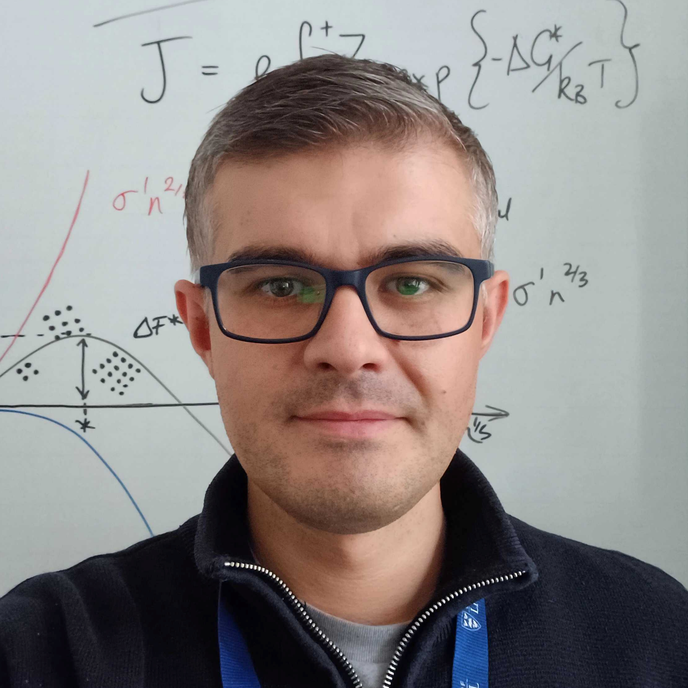
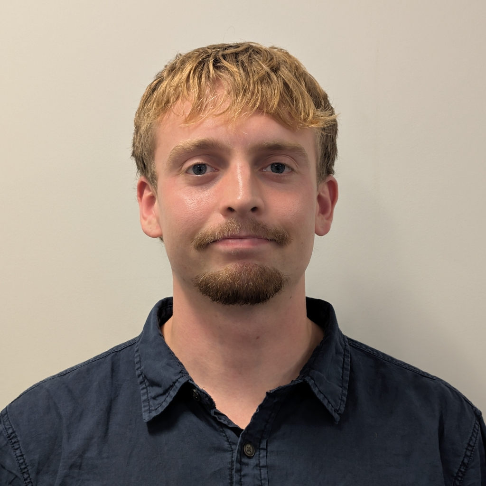
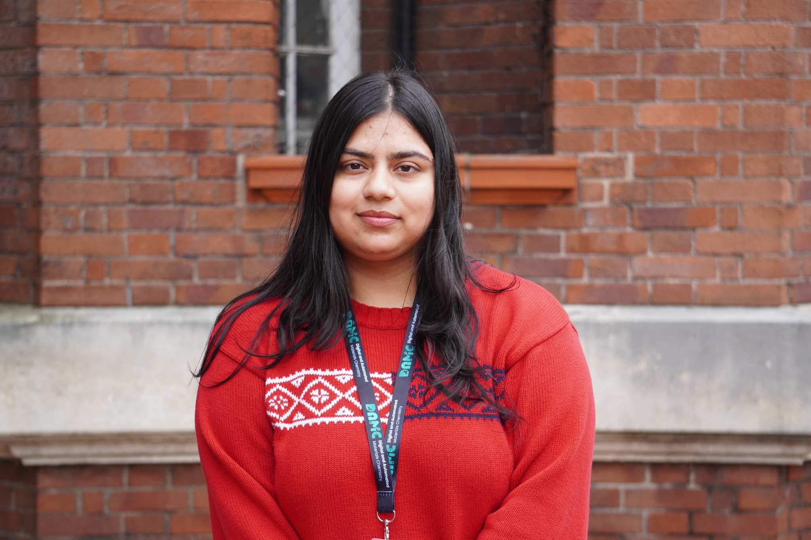

<!-- ## Aaron Finney Principal Investigator -->
## Aaron Finney Principal Investigator

Aaron is a Lecturer in Materials Science in the School of Engineering. He completed his PhD in Chemistry and Scientific Computing at the University of Warwick. From 2016 to 2019 he was an EPSRC Doctoral Prize Fellow and then Research Associate in Materials Science and Engineering at the University of Sheffield. Before moving to Liverpool in 2023, Aaron was a Senior Research Fellow in Chemical Engineering at University College London.

<a href="https://www.liverpool.ac.uk/people/aaron-finney" style="white-space:nowrap;"><i class="fa-solid fa-building-columns"></i> <strong>University profile</strong></a> •
<a href="https://scholar.google.com/citations?user=zHvnvwsAAAAJ" style="white-space:nowrap;"><i class="fa-brands fa-google-scholar"></i> <strong>Google Scholar</strong></a> •
<a href="https://orcid.org/0000-0002-1456-5892" style="white-space:nowrap;"><i class="fa-brands fa-orcid"></i> <strong>ORCID</strong></a> •
<a href="https://www.linkedin.com/in/aaron-finney-6410873a4/" style="white-space:nowrap;"><i class="fa-brands fa-linkedin"></i> <strong>LinkedIn</strong></a>

 

<!-- ## Xavier Sottrel Doctoral Researcher | 2026–  -->
## Xavier Sottrel Doctoral Researcher 2026–
Xavier combines Bayesian optimisation with molecular dynamics to guide sustainable formulation design, in a collaboration with Unilever. Using enhanced-sampling simulations, Xavier works out how strongly formulation ingredients bind to surfaces using free energy calculations. These binding free energies then inform a search through the large space of possible ingredients. The aim is to find greener ingredients that perform as well as current ones, using far fewer costly experiments. Xavier holds an undergraduate degree from the University of Liverpool, specialising in computational chemistry.

<a href="https://www.linkedin.com/in/xavier-sottrel-58538325a/" style="white-space:nowrap;"><i class="fa-brands fa-linkedin"></i> <strong>LinkedIn</strong></a>

<!--## Shaurya Aneja Doctoral Researcher | 2026–  -->
## Shaurya Aneja Doctoral Researcher 2026–
Shaurya builds and tests dynamic coarse-grained models of hydrogels, using enhanced sampling to explore their conformational space more efficiently. She combines these simulations with polarised rheo-microscopy to understand how hydrogels behave under flow, linking their microscopic structure to the bulk response. The aim is to predict how they perform in applications such as drug delivery and 3D printing. Shaurya holds a master’s degree in Chemistry from IIT Indore and was selected to attend the 74th Lindau Nobel Laureate Meeting.

<a href="https://www.liverpool.ac.uk/doctoral-training/digital-and-automated-materials-chemistry/research-community/student-profiles/cohort-2/shaurya/" style="white-space:nowrap;"><i class="fa-solid fa-building-columns"></i> <strong>University profile</strong></a> •
<a href="https://www.linkedin.com/in/shaurya-aneja-03b277205/" style="white-space:nowrap;"><i class="fa-brands fa-linkedin"></i> <strong>LinkedIn</strong></a>

<!--## Varnit Jain Doctoral Researcher | 2025–  -->
## Varnit Jain Doctoral Researcher 2025–
Varnit uses molecular dynamics simulations with classical and machine-learned potentials to understand the dynamic behaviour of complex electrolytes for next-generation batteries. He explores how the vast composition space of these electrolytes gives rise to different molecular assemblies, how these affect transport properties, and how they shape the chemistry at the anode–electrolyte interface. Varnit holds a BTech in Metallurgy and Materials Engineering from IIEST Shibpur, and was awarded a MITACS Globalink Research Internship at the University of Calgary.

<a href="https://www.liverpool.ac.uk/doctoral-training/digital-and-automated-materials-chemistry/research-community/student-profiles/cohort-1/varnit/" style="white-space:nowrap;"><i class="fa-solid fa-building-columns"></i> <strong>University profile</strong></a> •
<a href="https://scholar.google.com/citations?user=cWOaLtMAAAAJ" style="white-space:nowrap;"><i class="fa-brands fa-google-scholar"></i> <strong>Google Scholar</strong></a> •
<a href="LINKEDIN-URL-HERE" style="white-space:nowrap;"><i class="fa-brands fa-linkedin"></i> <strong>LinkedIn</strong></a>

## Project Students
**Ileen Sami** | 2026-2027 
**Cal McMullan** | 2026-2027

# Alumni
**Samuel Ike** MSc | 2025-2026  
**Abdulrahman Al-Sahli** BEng | 2024-2026  
**Joud Dhafer** BEng | 2024-2025  
**Alireza Azizian** MSc | 2024  
**Abby Balasubramaniyan** MSc | 2024  

