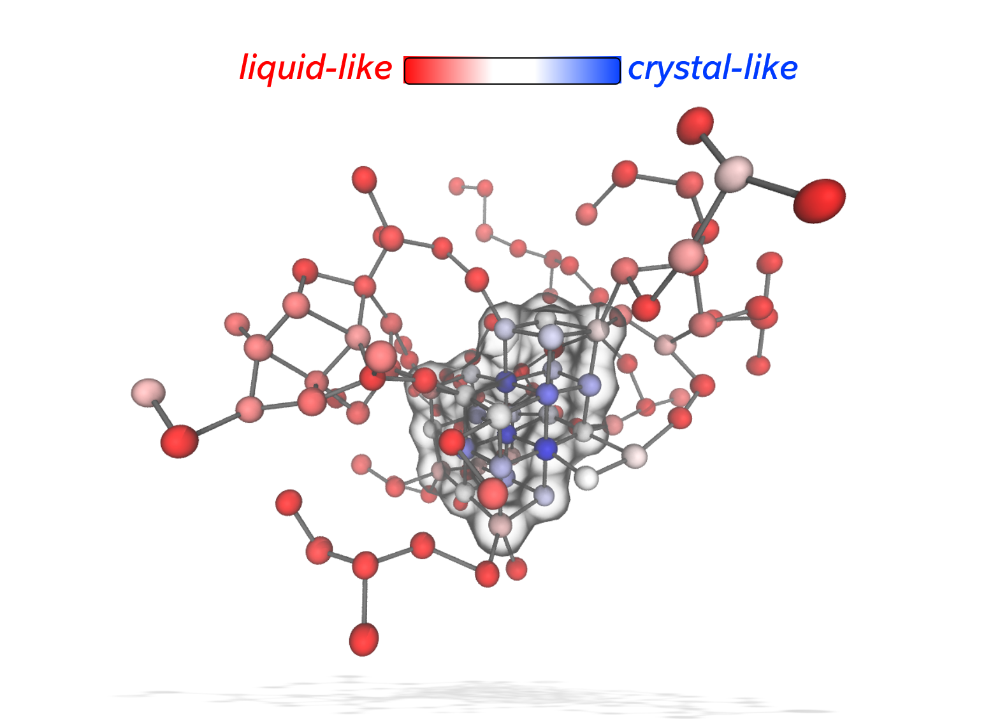
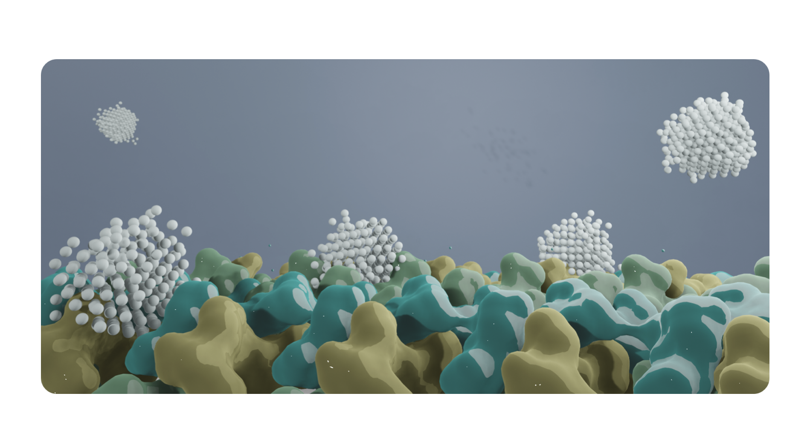
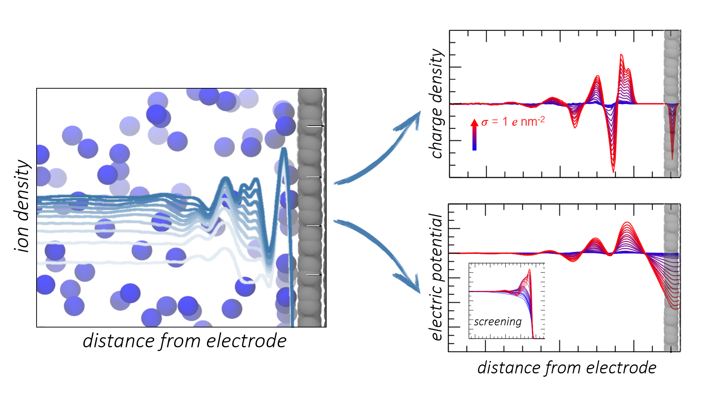
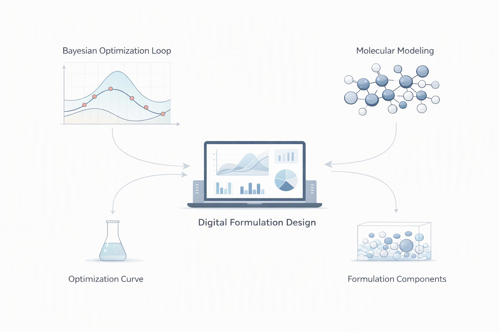

Our research sits at the junction of chemistry, physics and engineering. We use simulations to study materials from atomic to meso-scales, and combine them with data-science tools to understand how materials form and how their structure gives rise to their properties and performance. This lets us guide materials design and optimise processing. Our methods are not tied to any one class of material and we work across crystals, soft matter, interfaces and formulations. You can read about our current projects below.

Our latest publications are listed on <a href="https://scholar.google.com/citations?user=zHvnvwsAAAAJ" style="white-space:nowrap;"><i class="fa-brands fa-google-scholar"></i> <strong>Google Scholar</strong></a>. We share simulation code, input files and analysis tools openly on <a href="https://github.com/cmse-finney" style="white-space:nowrap;"><i class="fa-brands fa-github"></i> <strong>GitHub</strong></a>.

## Nucleation and Crystallisation

Nucleation is the first step when a new phase, such as a crystal, appears from solution. Classical theories often fail to predict the mechanisms and rates seen in practice. We use advanced simulation methods to reveal how nucleation and growth really happen, so that we can design strategies to promote or inhibit the formation of specific materials.

<i class="fa-solid fa-book-open"></i>&ensp;Read our <a href="https://wires.onlinelibrary.wiley.com/doi/full/10.1002/wcms.1697" style="white-space:nowrap;"><strong>review on simulating nucleation</strong></a> and our <a href="https://www.pnas.org/doi/abs/10.1073/pnas.1700342114" style="white-space:nowrap;"><strong>PNAS paper on nucleation</strong></a>.

## Self and Directed Assembly

Molecules and nanoparticles can organise spontaneously into complex structures, and external cues such as templates, fields and patterned surfaces can guide that process. We study the principles of self and directed assembly to identify design rules for making functional materials through low-temperature, bottom-up routes.

<i class="fa-solid fa-flask"></i>&ensp;Current projects include coarse-grained simulations of polymer gels and lamellar phases in formulated products.

## Solid–Liquid Interfaces

Interfaces between solids and liquids host much of the important physics and chemistry in catalysis, separations and energy storage. We study charged surfaces, such as graphite and graphene, in contact with electrolytes. Using constant chemical potential molecular dynamics, we quantify how surfaces change interfacial structure, mobility and solution thermodynamics.

<i class="fa-solid fa-book-open"></i>&ensp;Read our <a href="https://pubs.rsc.org/sc/article-abstract/12/33/11166/746236" style="white-space:nowrap;"><strong>Chemical Science paper on electrolytes at charged interfaces</strong></a>.

## Formulation Simulation and Design

Formulated products such as detergents, personal care products, lubricants and battery electrolytes are complex mixtures. How well they perform depends on how their components organise across many length scales. We use molecular and coarse-grained simulations to connect formulation chemistry to microstructure and to bulk performance. This shows how the choice of components and their concentrations control self-assembly, solute association and the thermodynamics of non-ideal solutions. We also combine these physics-based simulations with data science and machine learning, so that we can move beyond explaining formulations towards designing them "right first time", predicting performance before the first experiment.

<i class="fa-solid fa-flask"></i>&ensp;Current projects include combining enhanced sampling with Bayesian methods.

